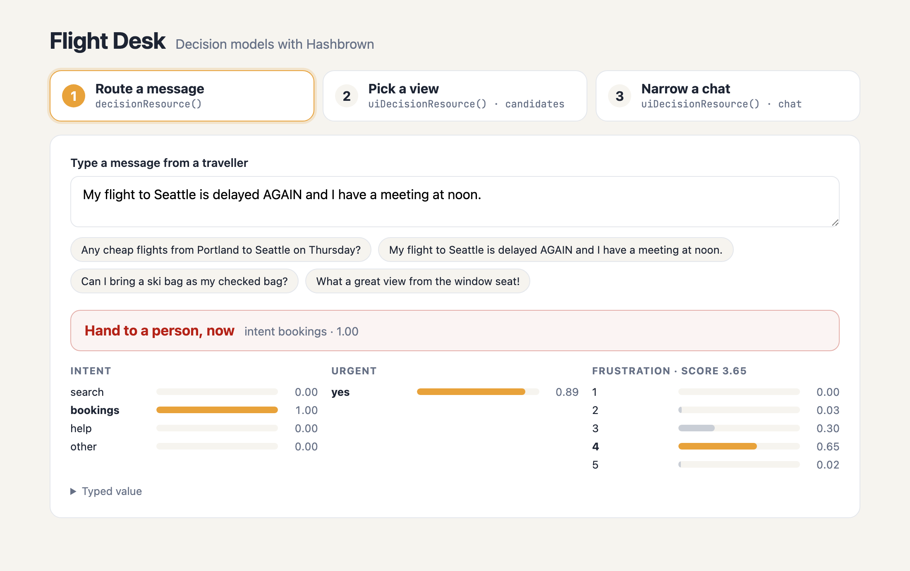

# Flight Desk: decision models with Hashbrown

A small Angular app that shows three ways to use a decision model with
[Hashbrown](https://hashbrown.dev) 0.8. It's the companion to the blog post
[Decision Models with Hashbrown: Decide, Then Generate](https://hashbrown.dev/blog/2026-10-27-decision-models-with-hashbrown).

This is a local demo. It is not deployed, and the server has no authentication.

| Step | Hashbrown API | What it shows |
| --- | --- | --- |
| 1. Route a message | `decisionResource()` | Three questions about one message (an enumeration, a yes or no, and a 1 to 5 score), answered as you type, plus a pure `routeAction()` policy |
| 2. Pick a view | `uiDecisionResource()` in candidates mode | The model picks one of three app-built views; the app supplies every prop |
| 3. Narrow a chat | `uiDecisionResource()` in chat mode | Before each message, a decision picks which cards the chat may render |



## Run it

You need Node.js 24, an [OpenAI](https://platform.openai.com) API key and a
[TypeSafe](https://typesafe.ai) API key.

```sh
npm install
```

Create `.env` in the project root (it's in `.gitignore`):

```sh
OPENAI_API_KEY=your-openai-key
OPENAI_MODEL=gpt-5-mini
TYPESAFE_API_KEY=your-typesafe-key
TYPESAFE_MODEL=jev-1.14.0
```

Start the server and the app in two terminals:

```sh
npm run server
```

```sh
npm start
```

Open http://localhost:4200. The Angular dev server proxies `/api` to the
server on port 3001.

## Where to look

- `shared/decisions.ts`: every decision's questions and context. The browser
  and the server import the same file, so the server can pin them.
- `shared/route-action.ts`: the app's policy for the router's answer, as a
  pure function.
- `src/app/route-panel.ts`: `decisionResource()`.
- `src/app/view-panel.ts`: `uiDecisionResource()` with `candidates`.
- `src/app/chat-panel.ts`: `uiChatResource()` with browser tools, and
  `uiDecisionResource()` with `chat`.
- `server/server.ts`: `/api/decide/:kind` with `HashbrownTypeSafe.decide`, and
  `/api/chat` with `HashbrownOpenAI`.

## Screenshots

`docs/screenshots` has every step, captured from live models.
